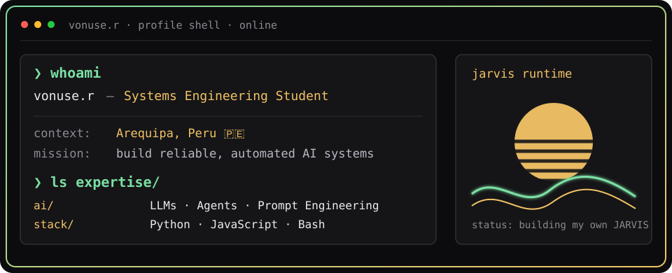

<!-- LOCAL CITY-POP BANNER -->
<a href="https://github.com/Zaiddd1">
  <picture>
    <source media="(prefers-color-scheme: dark)" srcset="assets/banner-dark.v9.svg">
    <source media="(prefers-color-scheme: light)" srcset="assets/banner-light.v9.svg">
    
  </picture>
</a>

 

<a href="https://github.com/Zaiddd1">
  <picture>
    <source media="(prefers-color-scheme: dark)" srcset="https://readme-typing-svg.demolab.com?font=JetBrains+Mono&amp;weight=700&amp;size=26&amp;duration=2600&amp;pause=900&amp;color=7BE0A4&amp;center=true&amp;vCenter=true&amp;width=900&amp;lines=vonuse.r+%E2%80%94+Systems+Engineering+Student%3BAI+Agents+%7C+Automation+%7C+Systems+Development%3BPython+%E2%80%A2+JavaScript+%E2%80%A2+Bash%3BBuilding+JARVIS+%E2%80%A2+Learning+%E2%80%A2+Iterating">
    <source media="(prefers-color-scheme: light)" srcset="https://readme-typing-svg.demolab.com?font=JetBrains+Mono&amp;weight=700&amp;size=26&amp;duration=2600&amp;pause=900&amp;color=1E9E5A&amp;center=true&amp;vCenter=true&amp;width=900&amp;lines=vonuse.r+%E2%80%94+Systems+Engineering+Student%3BAI+Agents+%7C+Automation+%7C+Systems+Development%3BPython+%E2%80%A2+JavaScript+%E2%80%A2+Bash%3BBuilding+JARVIS+%E2%80%A2+Learning+%E2%80%A2+Iterating">
    
  </picture>
</a>

<picture>
  <source media="(prefers-color-scheme: dark)" srcset="https://komarev.com/ghpvc/?username=Zaiddd1&amp;style=flat&amp;color=7BE0A4&amp;label=Profile+Views">
  <source media="(prefers-color-scheme: light)" srcset="https://komarev.com/ghpvc/?username=Zaiddd1&amp;style=flat&amp;color=1E9E5A&amp;label=Profile+Views">
  
</picture>

---

## `$ whoami`

  

 

## `$ cat tech-stack.yaml`

<table border="1" cellpadding="14" bgcolor="#17171c">
  <thead>
    <tr>
      <th colspan="2" align="left"><code>vonuse.r:~$ cat tech-stack.yaml</code></th>
    </tr>
  </thead>
  <tbody>
    <tr>
      <td width="50%" valign="top"><code>├─ ☁ cloud_infrastructure:</code>  
         
        <code>AWS · Azure</code>
      </td>
      <td width="50%" valign="top"><code>├─ ▣ databases:</code>  
         
        <code>MySQL · MongoDB</code>
      </td>
    </tr>
    <tr>
      <td colspan="2" valign="top"><code>╰─ ✦ languages_frameworks:</code>  
         
        <code>Node.js · JavaScript · React · TypeScript · Python · FastAPI · Bash</code>
      </td>
    </tr>
  </tbody>
  <tfoot>
    <tr>
      <td colspan="2"><code>status: ready&nbsp;&nbsp;·&nbsp;&nbsp;environment: production</code></td>
    </tr>
  </tfoot>
</table>

---

## `$ cat skills.radar`

  <picture>
    <source media="(prefers-color-scheme: dark)" srcset="assets/radar-dark.svg">
    <source media="(prefers-color-scheme: light)" srcset="assets/radar-light.svg">
    
  </picture>&nbsp;
  <picture>
    <source media="(prefers-color-scheme: dark)" srcset="assets/radar-langs-dark.svg">
    <source media="(prefers-color-scheme: light)" srcset="assets/radar-langs-light.svg">
    
  </picture>

<code>signals: ai_systems_radar · language_stack_radar · status: healthy</code>

 
 

Hecho con 💖 y mucho café desde Arequipa, Perú · @Zaiddd1

